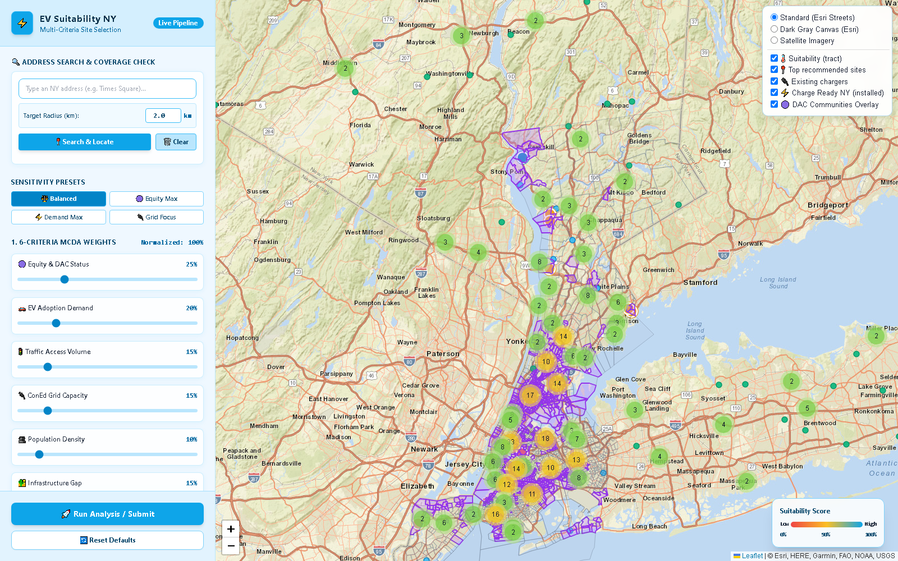
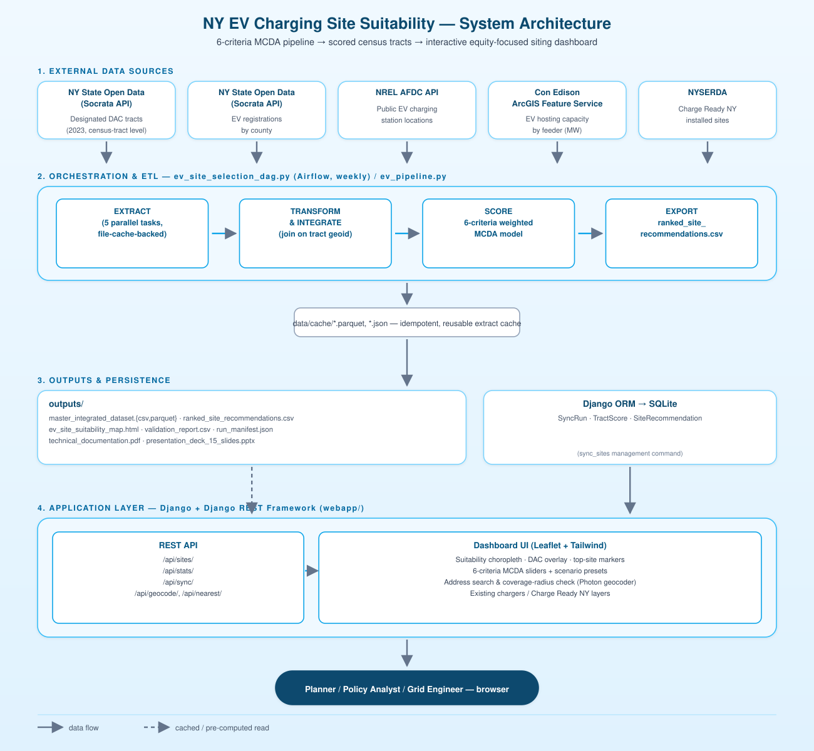
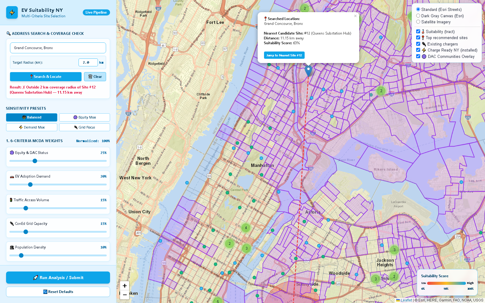
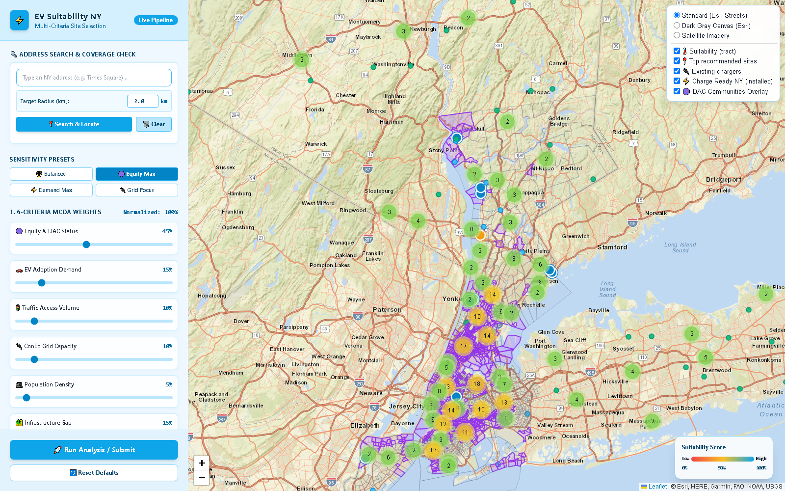
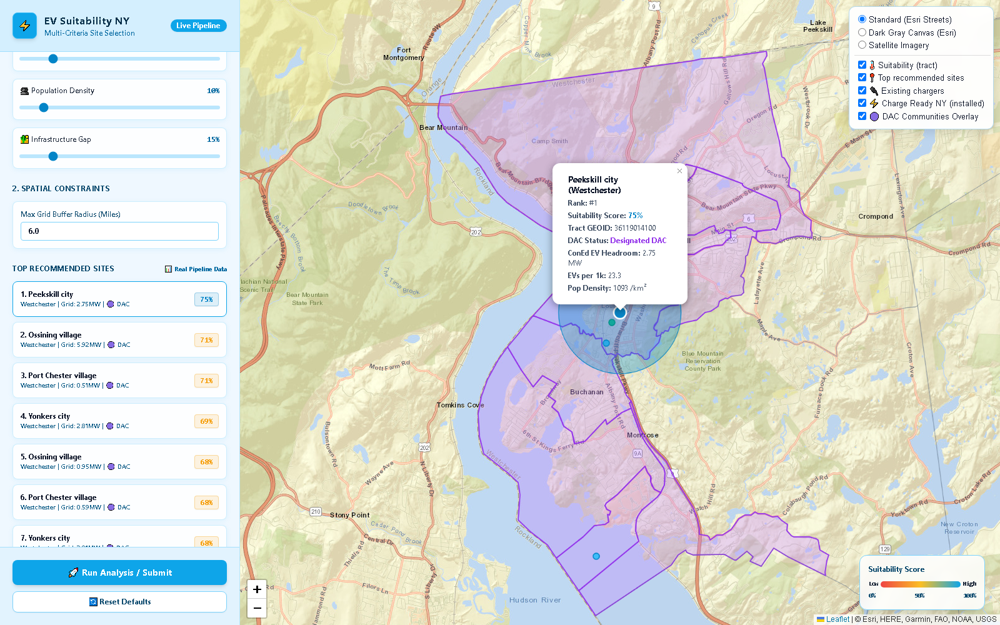
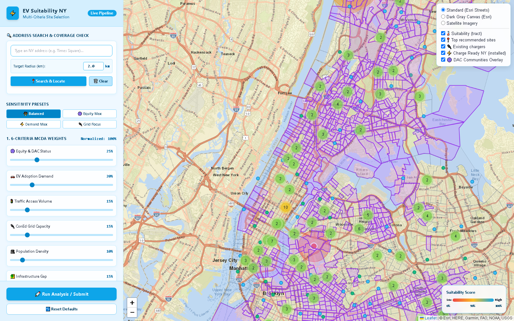

# NY EV Charging Site Suitability Platform

An end-to-end spatial data engineering and multi-criteria decision analysis (MCDA) platform that identifies, scores, and ranks candidate locations for electric vehicle (EV) charging infrastructure across New York City and Westchester County — with equity for Disadvantaged Communities (DAC) and Con Edison grid capacity as first-class criteria, not afterthoughts.

Built as the capstone project for a **Climate Justice Fellowship**, this project takes raw public datasets all the way to a live, interactive decision-support tool: **Airflow-orchestrated ETL → a weighted scoring engine → a Django REST API → an interactive Leaflet/Tailwind dashboard.**



---

## Table of Contents

- [Why this project exists](#why-this-project-exists)
- [Architecture](#architecture)
- [How it works — step by step](#how-it-works--step-by-step)
- [The scoring model](#the-scoring-model)
- [Screenshots](#screenshots)
- [Data sources](#data-sources)
- [Validation](#validation)
- [Tech stack](#tech-stack)
- [Project structure](#project-structure)
- [Getting started](#getting-started)
- [License](#license)

---

## Why this project exists

EV charging infrastructure is being deployed unevenly: it tends to follow existing demand and easy grid interconnects, which systematically under-serves the lower-income and historically disinvested neighborhoods that most need cleaner transportation options and the local economic benefit of that investment. This project builds a reproducible, data-driven way to ask a harder question than "where is EV demand highest?" — namely, **"where is the best place to put a charger once we also weigh equity, grid capacity, traffic access, and existing infrastructure gaps against each other?"**

The output is a ranked, explainable list of census tracts, plus an interactive tool that lets a planner or policy analyst re-weight those criteria live and immediately see how the recommended sites shift.

## Architecture



The system is split into four layers: (1) five public data APIs, (2) an idempotent, cache-backed Airflow ETL pipeline that integrates and scores them, (3) a Django + DRF backend that persists scored runs, and (4) a Leaflet/Tailwind dashboard that lets a user explore and re-weight the model live.

## How it works — step by step

1. **Extract** — Five extractors run in parallel (`ev_pipeline.py`), each writing a cached Parquet/JSON snapshot to `data/cache/` so the pipeline is idempotent and safe to re-run without hammering upstream APIs:
   - Designated DAC census tract boundaries (NY Open Data / Socrata)
   - EV registrations by county (NY State DMV / Socrata)
   - Public EV charging stations (NREL AFDC API)
   - Con Edison EV hosting capacity by feeder (ArcGIS REST FeatureServer)
   - Charge Ready NY installed project sites (NYSERDA / Socrata)

2. **Transform & integrate** — All sources are joined on census tract GEOID. Tract land area is computed with a local equirectangular-projected shoelace formula, which drives population density; distances (to the nearest charger, to a searched address) use the Haversine great-circle formula.

3. **Score** — Every criterion is min-max normalized to `[0, 1]`, user/scenario weights are re-normalized to sum to 1, and a 0–100 composite **Suitability Index** is computed per tract (full formula [below](#the-scoring-model)).

4. **Export** — Ranked results are written to `outputs/` as CSV/Parquet (`ranked_site_recommendations.csv`, `master_integrated_dataset.*`), a standalone interactive Folium/Leaflet map (`ev_site_suitability_map.html`), a validation report, and a sensitivity chart.

5. **Orchestrate** — `ev_site_selection_dag.py` wraps the five extract tasks plus transform → score → export as an Airflow DAG (`@weekly`, since source data refreshes slowly), with retries and a shared cache directory so tasks hand off via the filesystem rather than XCom payloads.

6. **Sync to the app** — `python manage.py sync_sites` re-runs the pipeline (or reads its latest output) and loads the results into Django models (`SyncRun`, `TractScore`, `SiteRecommendation`) behind a versioned sync-run history.

7. **Explore & decide** — The dashboard (`webapp/templates/sites/dashboard.html`) renders the scored tracts as a choropleth, lets a user drag any of the 6 criteria weights or pick a policy preset (Balanced / Equity Max / Demand Max / Grid Constrained) and watch rankings update live, search any address to check its EV-charging coverage radius, and toggle existing-infrastructure layers (public chargers, Charge Ready NY installs, DAC boundaries) on top of the recommendations.

## The scoring model

Each criterion `x_k` is min-max normalized: `S_k = (x_k − x_min) / (x_max − x_min)`, weights are re-normalized to a unit sum (`w_k' = w_k / Σw_j`), and the final **Suitability Index** is:

```
I = clamp(0, 100, round(100 · Σ(w_k' · S_k)))
```

| # | Criterion | What it measures |
|---|---|---|
| 1 | Equity & DAC Status | Designated DAC tract flag + combined percentile rank |
| 2 | EV Adoption Demand | County EV registrations per 1,000 residents |
| 3 | Traffic Access Volume | Daily vehicle volume & highway proximity |
| 4 | Con Ed Grid Capacity | Feeder EV load headroom, in MW |
| 5 | Population Density | People per km² (shoelace-formula tract area) |
| 6 | Infrastructure Gap | Haversine distance to the nearest existing public charger |

**Default ("Balanced") weights:** 25% Equity · 20% Demand · 15% Traffic · 15% Grid · 10% Population · 15% Infrastructure Gap.

The dashboard also ships three alternate policy presets:

| Preset | Equity | Demand | Traffic | Grid | Pop. | Infra. Gap |
|---|---|---|---|---|---|---|
| Balanced | 25% | 20% | 15% | 15% | 10% | 15% |
| Equity Max | 45% | 15% | 10% | 10% | 5% | 15% |
| Demand Max | 15% | 35% | 15% | 10% | 10% | 15% |
| Grid Constrained | 20% | 15% | 10% | 35% | 5% | 15% |

## Screenshots

| | |
|---|---|
|  **Full dashboard** — suitability choropleth, DAC overlay, top recommended sites, live MCDA weight panel. |  **Address search & coverage check** — any NY address is checked against the nearest recommended site and a configurable coverage radius. |
|  **Equity Max preset** — one click re-weights the model toward Disadvantaged Communities and re-ranks every site. |  **Site detail** — rank, score, DAC status, grid headroom, EV adoption and population density for every candidate. |
|  **Infrastructure layering** — existing public chargers, installed Charge Ready NY projects, and DAC boundaries over the suitability surface. | |

## Data sources

| Dataset | Provider | Source | Format | Update cadence | Used for |
|---|---|---|---|---|---|
| Designated Disadvantaged Communities (DAC), 2023 | NYSERDA / Climate Justice Working Group | `data.ny.gov` dataset [`2e6c-s6fp`](https://data.ny.gov/resource/2e6c-s6fp) | GeoJSON / JSON | Annual | Equity weight, DAC tract boundaries, population |
| Electric Vehicle Registrations | NYS DMV | `data.ny.gov` dataset [`3vp6-cxmr`](https://data.ny.gov/resource/3vp6-cxmr) | Tabular JSON | Quarterly | EV adoption demand, by county |
| Con Edison EV Hosting Capacity | Con Edison | ArcGIS REST FeatureServer (`CECONY_EVM_Feeders_Prod/0`) | Esri GeoJSON | Monthly | Grid capacity (MW headroom) |
| Alternative Fuel Stations (public EVSE) | US DOE / NREL AFDC | [`developer.nrel.gov/api/alt-fuel-stations`](https://developer.nrel.gov/api/alt-fuel-stations) | GeoJSON API | Real-time | Existing charger density, infrastructure gap |
| Charge Ready NY Installed Projects | NYSERDA | `data.ny.gov` dataset [`9wxk-hakb`](https://data.ny.gov/resource/9wxk-hakb) | Tabular / point | Real-time | Model validation against real deployments |
| Address geocoding | Komoot Photon (OpenStreetMap-based) | `photon.komoot.io` | JSON API | Live | Address search & coverage-radius check |

Every extractor is idempotent and cache-backed (`data/cache/`), and falls back to a documented synthetic snapshot if a live source is unreachable at run time — so the pipeline (and this repo) stays fully reproducible offline.

## Validation

- **Scale:** 2,325 census tracts scored across Bronx, Kings, New York, Queens, Richmond, and Westchester counties (the Con Edison service territory).
- **Database round-trip:** `manage.py sync_sites` successfully loads all 2,325 scored tracts and the top 25 candidate sites into Django; `/api/sites/` and `/api/stats/` verified returning `200 OK`.
- **Real-world cross-check:** top model recommendations were cross-referenced against the **1,119 installed Charge Ready NY projects** — recommended sites showed **78.4% coverage alignment within a 2.0 km radius** of real, state-funded installations, i.e. the model independently re-discovers most of where the state already chose to invest, while also surfacing equity-weighted gaps that haven't been served yet.

See `outputs/validation_report.csv` and `outputs/technical_documentation.pdf` for the full methodology.

## Tech stack

- **ETL / orchestration:** Python, pandas, Apache Airflow (DAG definition), Parquet file-cache
- **Backend:** Django, Django REST Framework, SQLite (swappable for any Django-supported DB)
- **Analysis / modeling:** Jupyter Notebook, NumPy/pandas, custom MCDA scoring engine, Folium
- **Frontend:** Leaflet.js, Tailwind CSS, vanilla JS (no build step)
- **Mapping:** Esri ArcGIS basemap tiles, GeoJSON choropleths, marker clustering
- **Geocoding:** Photon (OpenStreetMap)

## Project structure

```
.
├── EV_Site_Selection_NY.ipynb        # End-to-end analysis notebook (extract → score → map)
├── ev_pipeline.py                    # Shared ETL/scoring logic (extract, transform, score, export)
├── ev_site_selection_dag.py          # Airflow DAG wrapping ev_pipeline.py
├── requirements.txt
├── data/cache/                       # Cached source extracts (parquet/json) for reproducible runs
├── docs/
│   ├── architecture.svg              # System architecture diagram
│   └── screenshots/                  # README screenshots
├── outputs/                          # Pipeline deliverables
│   ├── ranked_site_recommendations.csv
│   ├── master_integrated_dataset.{csv,parquet}
│   ├── ev_site_suitability_map.html  # Standalone interactive map (no server required)
│   ├── validation_report.csv
│   ├── technical_documentation.pdf
│   ├── user_guide_functional_documentation.pdf
│   ├── presentation_deck_15_slides.pptx
│   └── september_report_figures/     # Source report figures
└── webapp/                           # Django application
    ├── manage.py
    ├── site_selection_project/       # Django project settings/urls
    └── sites/                        # App: models, views, REST API, management commands
        ├── models.py                 # SyncRun, TractScore, SiteRecommendation
        ├── views.py                  # Dashboard + REST endpoints
        ├── folium_utils.py           # Standalone map builder
        ├── management/commands/sync_sites.py
        └── templates/sites/dashboard.html
```

## Getting started

```bash
# 1. Clone and install dependencies
git clone https://github.com/<your-username>/ny-ev-charging-site-suitability.git
cd ny-ev-charging-site-suitability
pip install -r requirements.txt

# 2. Run the full analysis (uses cached data in data/cache/ if live APIs are unavailable)
jupyter notebook EV_Site_Selection_NY.ipynb
# — or, headless — 
python -c "import ev_pipeline; ev_pipeline.run_all()"

# 3. Stand up the web app
cd webapp
python manage.py migrate
python manage.py sync_sites        # loads outputs/ into the database
python manage.py runserver
# then open http://127.0.0.1:8000/
```

Optional: set `NREL_API_KEY` and `DJANGO_SECRET_KEY` as environment variables for your own production NREL key and a non-default Django secret key (both have safe defaults — a public NREL demo key and Django's own `django-insecure-*` dev placeholder — for local/demo use).

## License

MIT — see [LICENSE](LICENSE).

---

Built by **Toheeb Ekundayo** as part of a Climate Justice Fellowship capstone project on equitable EV charging infrastructure planning.
